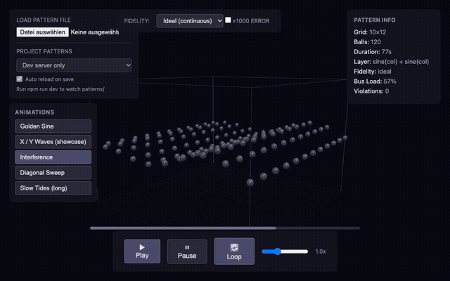

# Suspended Spheres — Kinetic Sculpture

A real-time kinetic art installation featuring **100–120 hollow chrome-finished plastic spheres** (Ø 60–80 mm, ≤ 50 g each) suspended in a grid (10 × 10 or 10 × 12, layout a proposal), each driven by an independent motor. The spheres move vertically over ~2 m, very slowly and smoothly, producing flowing waves, interference patterns, and choreographed visual symphonies. The system has three parts: a PC pattern-development and 3D-simulation environment, a Waveshare 7" ESP32 panel that runs the show and the operator UI, and the physical motor installation.

```
  ┌──────────────────────────────────────────┐
  │  ROW 1  :  ●  ●  ●  ●  ●  ●  ●  ●  ●  ●  │  ← 10 balls per row
  │  ROW 2  :  ●  ●  ●  ●  ●  ●  ●  ●  ●  ●  │
  │  ...                                     │
  │  ROW 12 :  ●  ●  ●  ●  ●  ●  ●  ●  ●  ●  │
  │                                          │
  │  12 rows × 10 columns = 120 balls        │
  │  Vertical travel: ~2000 mm (2 m)        │
  └──────────────────────────────────────────┘
```

---

## Quick Specs

| | |
|---|---|
| **Balls** | 100–120 hollow chrome-finish plastic (Ø 60–80 mm, ≤ 50 g) |
| **Grid** | 10 × 10 or 10 × 12 (layout proposal) |
| **Travel** | ~2000 mm (2 m) |
| **Footprint** | ~3 × 3 m (3 × 3.5 m possible), under a 3 m ceiling |
| **Motion** | mostly very slow and smooth; nominal fast tier 2 m in 4–5 s, optional short effects 2–3 s |

> The piece is designed for slow, hypnotic motion, with a faster tier for occasional effects. Free-fall and high-speed catch behaviour are not required.

---

## Documentation

All technical Markdown lives in [`doc/`](doc/). Only this file and [`AGENTS.md`](AGENTS.md) sit at the repository root.

| Document | Description |
|----------|-------------|
| [**System Requirements**](doc/system_requirements.md) | Formal functional and non-functional requirements, interfaces, constraints, assumptions |
| [**Mechanical Analysis**](doc/mechanical_analysis.md) | Speed ceiling, force/torque budgets, thread dynamics, inertia, drum and frame design |
| [**Controller Analysis**](doc/controller_analysis.md) | Platform and driver selection, stepping resolution, bus budget, clock drift |
| [**Motor Selection**](doc/motor_selection.md) | Trade study of cheap motor variants against the requirement set |
| [**Motion Streaming White Paper**](doc/motion_streaming_whitepaper.md) | Fly-Micro4 motion payload, RP2040/FastAccelStepper implementation, PC simulation architecture |
| [**ESP32 panel white paper**](doc/esp32gui_whitepaper.md) | Waveshare 7" ESP32-S3 show controller and LVGL operator UI; sources in `esp32gui/` |
| [**Motion streaming host TDD**](doc/motion_streaming_tdd.md) | Test-first plan for the motion core and the designer loop, with no hardware |
| [**Fly-Micro4 addressing**](doc/Fly_Micro4_addressing.md) | Node identity, commissioning and CAN-ID allocation for the selected board |
| [**Katapult white paper**](doc/katapult_whitepaper.md) | CAN bootloader build, BOOTSEL recovery, and in-place update of the Fly-Micro4 |
| [**Risk Register**](doc/RISK.md) | Dynamic loads, noise, architecture risks, and mitigations |
| [**Fly-Micro4 GPIO Map**](boards/Fly-Micro4/Fly-Micro4.h) | RP2040 pin assignments for the motion controller board |
| [**AGENTS.md**](AGENTS.md) | Mission and development-environment notes |

---

## Repository Structure

```
Suspended_Spheres/
├── README.md                   # This file — project overview and entry point
├── AGENTS.md                   # Mission, overview, development notes
├── lib/
│   ├── motion_core/            # Shared integer motion core (PC and firmware)
│   └── pattern_core/           # Pattern bake, limits, report and .hbp export
├── tests/                      # Host-only harness (CMake; no hardware)
├── tools/                      # Headless pattern checker
├── wasm/                       # Native/WASM parity driver
├── rp2040/                     # Fly-Micro4 firmware (PlatformIO)
├── webapp/                     # Designer 3D viewer (Vite + Three.js)
├── patterns/                   # .anim.json example patterns
├── esp32gui/                   # Show controller and LVGL UI (PlatformIO + host PNGs)
├── boards/
│   ├── Fly-Micro4/
│   │   ├── Fly_Micro4_pinmap.md    # Pin reference for the vendor files
│   │   ├── Fly_Micro4_klipper_reference.cfg
│   │   ├── Fly-Micro4.h            # GPIO map for firmware
│   │   ├── Fly-Micro4-schematic.pdf
│   │   ├── Fly-Micro4.step
│   │   └── pin.webp                # Connector pinout
│   └── WAVESHARE-ESP32-S3-Touch-LCD-7-7inch/
│       ├── README.md
│       ├── source/                 # LCD, SD, TWAI and CH422G vendor code
│       └── *.pdf, *.jpg, *.webp    # Schematics and board photos
└── doc/
    ├── system_requirements.md
    ├── mechanical_analysis.md
    ├── controller_analysis.md
    ├── motor_selection.md
    ├── motion_streaming_whitepaper.md
    ├── esp32gui_whitepaper.md     # Waveshare panel: show controller and UI
    ├── motion_streaming_tdd.md    # Host tests that need no hardware
    ├── Fly_Micro4_addressing.md   # Node identity and CAN-ID allocation
    ├── katapult_whitepaper.md     # CAN bootloader and in-place firmware update
    ├── BOM_summary.md
    ├── BOM_priced.csv
    └── RISK.md
```

---

## Patterns

Sine Wave · Standing Wave · Spiral · Random Cascade · Music Reactive · Breathing · Diagonal Wave · Custom Choreography

---

## See the 3D viewer first



This animated GIF needs no Node.js, no Python and no installation, and it plays
inline on GitHub, iPad Safari and desktop browsers.

GitHub does **not** embed `<video>` in README files; raw video links are
downloaded or opened in a new page. The full-quality **30 s MP4** is still in
the repository at [`doc/media/viewer-demo.mp4`](doc/media/viewer-demo.mp4) for
offline viewing.

The interactive viewer is hosted at
<https://gin66.github.io/suspended-spheres/> and is also available as one file:
[`webapp/viewer-standalone.html`](webapp/viewer-standalone.html). Download the
ZIP, unzip it and double-click that file. The steps below are only for the
authoring loop that watches `patterns/`.

**LLM render links.** The hosted page accepts the pattern in the URL fragment,
so an LLM can return a one-click preview without a server or an upload:

```
https://gin66.github.io/suspended-spheres/#pattern=<payload>
```

`<payload>` is `g1.` followed by base64url(gzip(UTF-8 `.anim.json`)), or `j1.`
followed by base64url(UTF-8 JSON) when compression is unavailable. Open a
pattern in the viewer and press **Copy link** to generate one. The fragment is
never sent to the server, and no API key or file hosting is needed.

## Run the 3D Viewer

### One-click viewer (no Node.js, no server, no terminal)

1. Download the project ZIP from
   <https://github.com/gin66/suspended-spheres> (green **Code** button).
2. Unzip it.
3. Double-click `webapp/viewer-standalone.html`.

That one file contains the viewer, Three.js and the WASM motion core, so it
runs offline from `file://`. Built-in animations, play/pause, loop, fidelity,
timeline, pattern-file loading and camera orbit all work. The only thing it
cannot do is watch `patterns/` for live edits.

The standalone file is prebuilt and checked in; you do not need to rebuild it.
If you change `webapp/src/` and have Node.js, regenerate it with:

```sh
cd webapp
npm install
npm run build:standalone
```

### Authoring loop (optional, needs Node.js)

The steps below add the live pattern list, auto-reload on save and report
writing. Install the **LTS** version of Node.js from <https://nodejs.org/> and
accept the defaults. To check the install:

```sh
node --version
npm --version
```

Open a terminal **in the `webapp` folder**:

- **macOS:** right-click the `webapp` folder → **Services** → **New Terminal at Folder**
- **Windows:** Shift-right-click the `webapp` folder → **Open PowerShell window here**
- **Linux:** right-click inside the folder → **Open in Terminal**

Then run:

```sh
npm install
npm run dev
```

`npm install` downloads the 3D library and may take a minute. `npm run dev`
prints a local address, normally <http://localhost:5173/>. Open that address in
a browser. Leave the terminal open while you use the viewer; press `Ctrl+C` in
the terminal to stop it.

The shared integer motion core is prebuilt in `webapp/src/wasm/pattern_core.js`,
so you do not need Emscripten. After changing code under `lib/`, rebuild it with
`./wasm/build_viewer.sh`.

### Use the viewer

- Click an animation under **Animations** on the left to switch to it.
- **Play / Pause**, **Loop**, the speed slider, and the timeline control the show.
- **Fidelity** switches between the ideal curve, the 16-bit wire values, and the microstep grid.
- **Load Pattern File** opens a `.anim.json` file. Try `patterns/golden_sine.anim.json` from the project folder.
- Drag to orbit the camera and scroll to zoom.
- Red spheres and the violation banner mark positions outside the allowed limits.

### If you cannot or do not want to install npm

The one-click standalone file above needs neither npm nor Python. For the
authoring loop without Node.js, Python 3 can serve the source folder instead:

```sh
cd webapp
python3 -m http.server 8000
```

Then open <http://localhost:8000/>.

### Common problems

| Problem | Fix |
|---------|-----|
| `npm: command not found` | Install Node.js LTS, then open a new terminal |
| Blank page when opening `index.html` directly | Do not double-click the file; use `npm run dev` or the Python server above |
| Address already in use | `npm run dev -- --port 5174`, or pick another Python port |
| The 3D view does not load | Check the internet connection; Three.js comes from a CDN |

---

## Create and edit animations

Patterns are plain `.anim.json` files in [`patterns/`](patterns/). The version-1
schema and layer types are described in the whitepaper §6.9. An agent such as
opencode can edit these files directly.

The authoring loop is:

1. Start the viewer with `npm run dev` in `webapp/`.
2. Select a file under **Project Patterns**. The viewer watches it and reloads
   automatically when the file is saved.
3. Edit or generate `patterns/<name>.anim.json` with opencode, or ask opencode
   to create a new one.
4. Check it from the repository root:

   ```sh
   cmake --build build
   ./build/pattern_check patterns/<name>.anim.json
   ```

   The checker writes `patterns/<name>.report.json` and exits non-zero if the
   take breaks travel, speed, acceleration, step or bus limits.
5. Read the report, adjust the JSON, and repeat until `violations` is empty.
6. Optionally export a clean take:

   ```sh
   ./build/pattern_check patterns/<name>.anim.json \
     --hbp patterns/<name>.hbp
   ```

   The `.hbp` file is a single HBP2 playback container with precomputed
   8-byte wire frames and a block table, ready for the Waveshare SD card.

For files loaded through the **Project Patterns** list, the viewer shows the
same violations in its banner and writes the report when it rebakes. A file
that does not parse keeps the last good animation on screen and shows the parse
error in the pattern status line.

---

## Use Claude or another LLM in a browser

Claude produced a good “walking peak” visual from this prompt. Use it as a
starting point and replace the motion description with your own idea. It is
written for a browser chat with **no repository access**, so the model only
returns text and links.

**English**

> I want to use the animations from
> https://github.com/gin66/suspended-spheres. Design goal: a walking peak
> running in circles.
>
> Follow this workflow exactly:
>
> 1. Understand and clarify the goal. Ask concise questions about the grid,
>    timing, amplitude, direction, looping and the visual shape. Do not produce
>    the final file yet.
> 2. Develop the animation structure. List the layers and their fields (`op`,
>    `amplitude_um`, `period_ms`, `wavelength_cols`, `phase_deg`, `axis`,
>    `group`) and explain how they combine. Keep it inside the ordinary tier.
> 3. Show the result in the hosted viewer and wait for my approval or revision
>    notes. Use https://gin66.github.io/suspended-spheres/ . Give me a clickable
>    link of the form
>    `https://gin66.github.io/suspended-spheres/#pattern=g1.<base64url(gzip(json))>`
>    (plain `j1.<base64url(json)>` is also accepted). If you cannot build the
>    link, say so and give me the complete version-1 `.anim.json` in a code
>    block. I will load it with **Load Pattern File** and confirm the preview.
> 4. Only when I ask for the file, output the final `.anim.json` as a
>    downloadable code block. Do not create `.hbp`; I will run `pattern_check`
>    locally.
>
> References:
> - Schema: https://github.com/gin66/suspended-spheres/blob/main/doc/motion_streaming_whitepaper.md
>   (section 6.9)
> - Example: https://github.com/gin66/suspended-spheres/blob/main/patterns/golden_sine.anim.json
> - Viewer: https://gin66.github.io/suspended-spheres/

**Italiano**

> Voglio usare le animazioni di
> https://github.com/gin66/suspended-spheres. Obiettivo: un picco che cammina
> muovendosi in cerchi.
>
> Segui esattamente questo flusso:
>
> 1. Comprendi e chiarisci l’obiettivo. Fai domande concise su griglia, tempi,
>    ampiezza, direzione, looping e forma visiva. Non produrre ancora il file
>    finale.
> 2. Sviluppa la struttura dell’animazione. Elenca i layer e i loro campi (`op`,
>    `amplitude_um`, `period_ms`, `wavelength_cols`, `phase_deg`, `axis`,
>    `group`) e spiega come si combinano. Mantieniti nel tier ordinary.
> 3. Mostra il risultato nel viewer ospitato e attendi la mia approvazione o le
>    mie richieste di modifica. Usa https://gin66.github.io/suspended-spheres/ .
>    Dammi un link cliccabile del tipo
>    `https://gin66.github.io/suspended-spheres/#pattern=g1.<base64url(gzip(json))>`
>    (è accettato anche `j1.<base64url(json)>`). Se non riesci a costruire il
>    link, dillo e dammi il file `.anim.json` versione 1 completo in un blocco
>    di codice. Lo caricherò con **Load Pattern File** e confermerò
>    l’anteprima.
> 4. Solo quando te lo chiedo, restituisci il file `.anim.json` finale in un
>    blocco di codice scaricabile. Non creare `.hbp`; eseguirò `pattern_check`
>    in locale.
>
> Riferimenti:
> - Schema: https://github.com/gin66/suspended-spheres/blob/main/doc/motion_streaming_whitepaper.md
>   (sezione 6.9)
> - Esempio: https://github.com/gin66/suspended-spheres/blob/main/patterns/golden_sine.anim.json
> - Viewer: https://gin66.github.io/suspended-spheres/

The preview-first request is deliberate: judge the motion before the model
commits to the JSON. Models that cannot encode the `#pattern=` link must use the
JSON fallback and **Load Pattern File**; that still satisfies step 3 as long as
the model waits for approval before emitting the final file. The local authoring
loop above remains the way to run `pattern_check` and export `.hbp`.

**Success rate varies.** Model quality, context size, language and how precisely
the motion is described all matter. Expect several iterations: a model may
produce invalid JSON, ignore a schema field, or pick amplitudes that exceed the
tier limits. The preview and `pattern_check` exist to catch those cases; do not
treat the first answer as final. Smaller or older free models are more likely to
need manual correction.

---

## Use opencode's free models

opencode includes a rotating list of **free, limited-time models** served by
OpenCode Console. You do not need Ollama, a separate provider, or a paid
subscription to try them. Availability changes often, so `/models` inside
opencode is the authoritative list.

### 1. Install opencode

```sh
curl -fsSL https://opencode.ai/install | bash
```

Alternatives are `brew install anomalyco/tap/opencode` on macOS/Linux or
`npm install -g opencode-ai` if Node.js is already installed.

### 2. Connect the OpenCode provider

1. Run `opencode` from this repository.
2. Run `/connect` and choose **OpenCode** / **OpenCode Console**.
3. Sign in at <https://opencode.ai/console>, create an API key if needed, and
   paste it into opencode.
4. Run `/models` and select a model whose name includes **Free**.

The free models are under the `opencode/` provider. Current examples from the
OpenCode Console catalogue (limited-time availability):

| Model | Model selector |
|-------|----------------|
| GLM-5.3-Flash Free | `opencode/glm-5.3-flash-free` |
| DeepSeek V4.1 Flash Free | `opencode/deepseek-v4.1-flash-free` |
| MiMo-V2.6-Flash Free | `opencode/mimo-v2.6-flash-free` |
| Nemotron 3 Ultra Free | `opencode/nemotron-3-ultra-free` |
| Nemotron 3.5 Lightning Free | `opencode/nemotron-3.5-lightning-free` |
| Nemotron 3.5 Super VL Free | `opencode/nemotron-3.5-super-vl-free` |
| Big Pickle | `opencode/big-pickle` |
| Pulse Alpha Free | `opencode/pulse-alpha-free` |
| Beam Free | `opencode/beam-free` |
| Flint 40B Free | `opencode/flint-40b-free` |
| Jev 1.13 Free | `opencode/jev-1.13-free` |

Some models are region-restricted. The list, limits, and privacy terms can
change without notice; check `/models` and the OpenCode Console before relying
on one.

### 3. Optional: make one the default

Select it once with `/models`, or put its exact selector in `opencode.json`:

```json
{
  "$schema": "https://opencode.ai/config.json",
  "model": "opencode/glm-5.3-flash-free"
}
```

For a one-off run:

```sh
opencode run --model opencode/deepseek-v4.1-flash-free "Explain the motion core"
```

### If the free models do not appear

- Make sure `/connect` finished and the OpenCode provider is signed in.
- Remove `OPENCODE_DISABLE_FREE_MODELS` from the environment; setting it to `1`
  hides free models.
- Run `/models` again. A signed-out OpenCode provider is absent, so connecting
  the account is what restores the catalogue.

Do not commit API keys. opencode stores credentials in
`~/.local/share/opencode/auth.json`; keep that file private. Some free models
may use submitted data for training or feedback—check the Console privacy notes
before using confidential material.

---

## Status

| Area | Status |
|------|--------|
| **Concept & Documentation** | ✅ Complete |
| **Mechanical Design** | 🔄 In Progress |
| **Controller Hardware** | Fly-Micro4 selected; insert J3 only on the last board (all others open, no 120 Ω). Waveshare CAN jumper set to 120 Ω; no desoldering |
| **Show controller** | Waveshare ESP32-S3-Touch-LCD-7 selected; sources in `esp32gui/` (CAN mock until the bus is wired) |
| **Firmware** | ⏳ Planned |
| **Simulation** | ✅ 3D viewer uses the shared WASM core; pattern export in progress |
| **Prototype** | ⏳ Planned |

---

*Built with curiosity, physics, and a love of kinetic art.*
